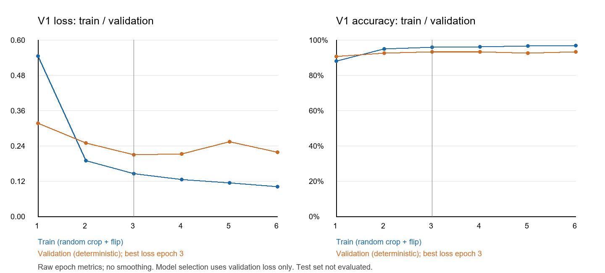
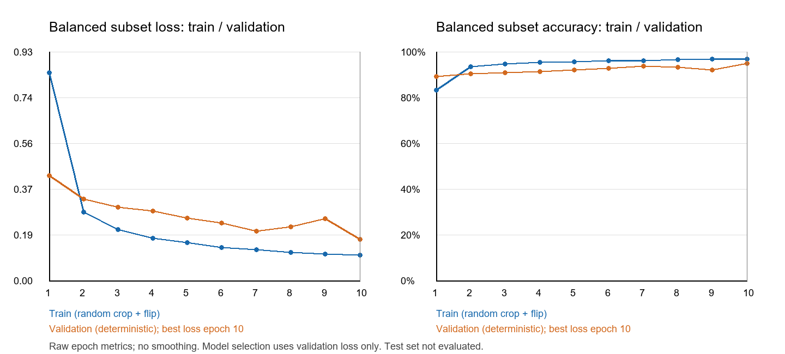

# 实验结果与模型身份

所有数值复用既有真实结果文件，本次提交没有训练或重新评价测试集。

| 实验与阶段 | Accuracy | Macro F1 | 说明 |
| --- | --- | --- | --- |
| 原模型第3轮验证 | 93.30% | 92.20% | 用于选模 |
| 原模型最终测试 | 93.20% | 92.24% | 8567/9192，网页采用此模型 |
| 均衡模型第10轮验证 | 94.92% | 94.21% | 独立实验，未最终测试，未替换网页 |

原实验实际训练6轮，patience3早停，最低验证loss对应第3轮。均衡实验39类各582张共22698张，从ImageNet缓存和新分类头开始训练10轮，最佳第10轮。两模型冻结主干及BatchNorm统计，Adam、lr0.001、batch_size32、seed42、num_workers0，使用相同验证预处理。

原始61486张，字节代表61274张，正式训练42890、验证9192、测试9192。固定划分目录在仓库`splits/formal_sha256_seed42_v1`，清单和锁保持原字节；原始图片未上传。

## 证据文件

- [原最终测试指标 全部39类](results/original_test_metrics.json)
- [原最终测试逐类CSV](results/original_test_per_class.csv)
- [原测试错分类别对 含比例](results/original_test_confusion_pairs.csv)
- [原训练逐轮日志](results/original_training_metrics.csv)
- [均衡训练逐轮日志](results/balanced_training_metrics.csv)
- [同一验证集的完整对照](results/validation_comparison.json)
- [全部39类验证对照CSV](results/validation_per_class_comparison.csv)





## 冻结身份

网页模型为`best_epoch_003.pt`，SHA256：

```text
1c464873a01b10e1dce89211859a0a9bfe1448a765ecfaef4ed57089436c6b2f
```

固定划分标识：

```text
553a89fd302dd00cf3abc2e8554151a66a053dcc0edec0d9fc4ee82159a4f8d8
```

权重不进入Git，以老师交付包中的文件及SHA256核对。现有FINAL_MODEL.json保留原项目位置用于追溯；老师包中的副本改用相对模型/指标路径，类别、预处理和模型哈希不变。

## 限制

已排除已知SHA256字节重复，未排除增强同源关系，成绩可能偏乐观。原测试集已查看，不用于反复调参。均衡对照同时改变训练图片数及更新次数，不是单因素因果实验；验证成绩不等于独立最终测试。

原模型马铃薯晚疫病测试recall为54.67%（support150），番茄二斑叶螨危害为60.56%（support251），低分类别保留完整指标。真实拍摄泛化和真实严重程度/田间风险没有专项验证。
